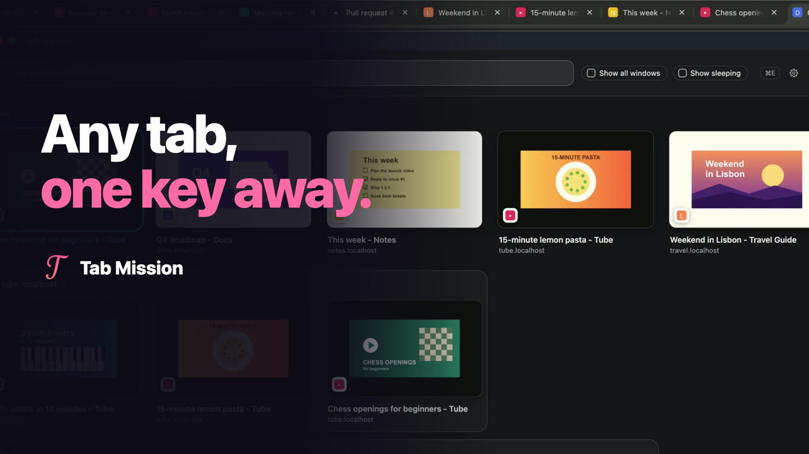

<p align="center">
  
</p>

<h1 align="center">Tab Mission</h1>

<p align="center">
  <a href="https://chromewebstore.google.com/detail/tab-mission/hhnkkpdkfhjlmlanebphmmhgkhinijca?utm_source=github&utm_medium=readme"></a>
  
</p>

<p align="center">
  <a href="https://youtu.be/uhrcGRLRPa8"></a>
  <br>
  <a href="https://youtu.be/uhrcGRLRPa8">▶ Watch the tutorial</a>
</p>

---

One shortcut shows the tabs in your window as cards, most recent first, with pictures of the pages you've seen. Press it again to go back to your last tab, or point at a card or type a few letters and press it again to go there.

## ✨ Features

- **Back and Forth:** The tab you were on before takes the first card and is already selected, so pressing the shortcut again takes you back; twice more, and you are where you started. Your current tab sits second, then your other recent tabs.
- **Point and Tap:** Keep holding `Cmd` (or `Ctrl + Shift`) after the shortcut, point at a card and tap `E`. Or let go, point, and press the whole shortcut again.
- **Type to Search:** The search box is ready as soon as Tab Mission opens. Every word you type must match the title or URL, the best match is selected, and pressing the shortcut again takes you there. A search covers all windows and sleeping tabs; without one, the cards follow the two toggles above them.
- **Site View:** When Tab Mission shows two or more tabs from the website you are on, press `Tab` in the search box to see only those (`Tab` again, `Backspace` at the start of the box, or `Esc` once the box is empty, to leave). A shortcut of its own can be assigned at `chrome://extensions/shortcuts`; it has no default so it never clashes with other extensions.
- **Grouped by Site:** Your five most recent tabs come first (the previous tab still the first card), then a panel for each site with two or more tabs, which switching tabs never moves; the rest come last. It makes the same groups at any window size; a narrower window fits fewer cards in a row, and the panels may come in another order to fill each row. You can turn it off in the settings.
- **Any Size:** Drag the Tab Mission window to any size or place, even a tall strip at the side of your screen, and it remembers both; the reset button next to the gear brings back the default.
- **Keyboard or Mouse:** `↑↓←→` + `Enter`, or click. Middle-click or `×` closes a tab; `Shift + Delete` closes the selected card's tab (`Shift + fn + Delete` on a Mac laptop; `Shift + Backspace` also works while the search box is empty). `Esc` steps back: it clears the search, then leaves the site view, then closes.
- **Page Pictures:** Each card shows a small picture of the page, taken while it was in front of you and kept after a restart, with its title underneath; until it has one, the preview image the page provides (not a logo), or the site's icon on a card in the icon's color. Light or dark, as your system is.
- **Private by Design:** No developer-run server, analytics or tracking. Tab information and page pictures stay on your computer (a tab's picture is deleted when you close the tab, none is taken of incognito tabs, and turning page pictures off in the settings deletes them all); preview images load from their original hosts, and site icons come from Chrome's own store.

## 🚀 Getting Started

1.  **[Install Tab Mission from the Chrome Web Store](https://chromewebstore.google.com/detail/tab-mission/hhnkkpdkfhjlmlanebphmmhgkhinijca?utm_source=github&utm_medium=readme)**.
2.  Click the extension icon or use the default shortcut: **`Cmd + E`** on Mac, **`Ctrl + Shift + E`** on Windows, Linux and ChromeOS. If another extension already owns it, pick your own at `chrome://extensions/shortcuts` (the gear in Tab Mission opens its settings, which show your shortcut and a button to that page). While assigned, the shortcut takes priority over the same key on web pages, such as GitHub's `Cmd + E` for inline code or Google Docs' `Ctrl + Shift + E` for center align; choose another key if you rely on one.
3.  Press the shortcut again to go back, point at a card and press it to go there, or type a few letters and press it again.

## 💡 Pro Tips

- **Toggle style (optional):** click the gear in Tab Mission and turn off "Pre-select the previous tab"; then nothing is selected on open, and pressing the shortcut again closes Tab Mission.

## 🛠️ Development

Plain JavaScript, no build step: `extension/` is exactly what ships. With Node 24:

```sh
npm ci
npm run check      # lint, manifest checks, unit tests
npx playwright install chromium
npm run test:e2e   # end-to-end tests in Playwright's Chromium
npm run package    # builds/tab-mission-<version>.zip
```

To try your changes, load `extension/` at `chrome://extensions` (Developer mode, then "Load unpacked").

## 💬 Feedback & Support

Questions, bugs and ideas are welcome: **[open an issue](https://github.com/kuk1song/Tab-Mission/issues)**, where others with the same question can find the answer.

## 🛡️ Privacy & Open Source

Tab Mission is free and open source (MIT). It processes tab information and page pictures in your browser, does not upload your tab list, search text or pictures to the developer, and does not sell user data. Preview images load from websites or their image hosts. Details, including local storage and why each permission is needed, are in the [**Privacy Policy**](PRIVACY.md).

Permissions: `tabs` to list, switch and close tabs; `favicon` for site icons from Chrome's own store; `scripting` and access to all sites for the page pictures and preview images; `system.display` to place the window on your screen; `storage` for settings, page pictures and the other data the Privacy Policy lists.

The MIT license covers the code. It does not grant rights to the Tab Mission name or logo as a trademark, so please give forks and derived extensions a different name and icon.

---

<p align="center">
  Made by <a href="https://github.com/kuk1song">Haokun Song</a>
</p>
